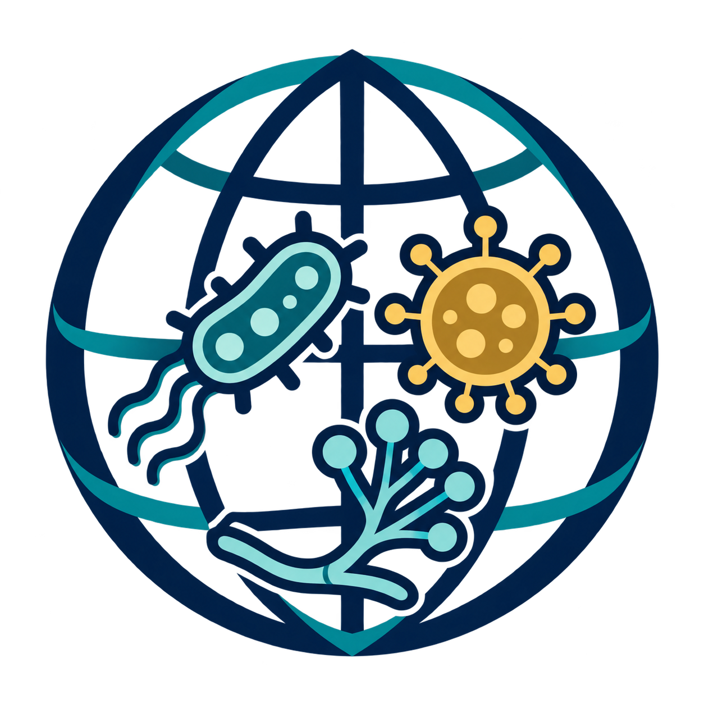

  

# Pathogen Atlas V3

The Pathogen Atlas brings together published reports of microorganisms associated with human disease and the evidence that supports those associations. Version 3 is being built to represent bacteria, fungi, and viruses in one auditable research resource while respecting the differences in their taxonomy and biology.

The Atlas is an evidence map, not a complete census of pathogens or proof that an organism is harmless when evidence is sparse. Its organism profiles reflect the literature retrieved, the abstracts available, and the questions used to assess them. Feature scores describe what those abstracts report; they are not measures of disease prevalence or risk.

V3 keeps a shared catalogue of research features and selects relevant features for each organism group. Species identity and literature evidence retain source and version information, and model probabilities remain separate from released labels until evaluated against human-labelled examples.

## Explore

Open the [Pathogen Atlas Evidence Explorer](https://fabriziocosta.github.io/pathogen-atlas-v3/) on GitHub Pages. It displays human pathogens only: 1,703 bacterial profiles from V2 and 257 virus profiles with accepted V3 Jev pathogen evidence. Profiles include supporting PubMed IDs, titles, and Jev confidence scores. Organism groups without accepted human-pathogen evidence are omitted; fitted coordinates are not yet released.

The static Explorer source is in [`sites/pathogen-atlas-explorer`](sites/pathogen-atlas-explorer/). Generated public data is published as a GitHub Release asset, rather than committed to the source repository, and the Pages workflow assembles the application and data at deployment time.

## Project structure

- `pathogen_atlas_v3/` contains reusable, inspectable phase code.
- `configs/` contains versioned taxonomy, query, prompt, and feature definitions.
- `notebooks/` exposes phase inputs and calls in execution order; reusable logic stays in Python modules.
- `data/` holds the local V2 migration snapshot, caches, and generated releases. All data files are excluded from Git.
- `docs/` records data contracts, scientific decisions, migration rules, and methods.

See [the project workflow](docs/workflow.md) to install and run phases, [the multi-domain data model](docs/data_model.md) for organism and feature contracts, [the feature taxonomy decision](docs/feature_taxonomy_decision.md) for how feature concepts are organized and reviewed, and [the embedding method](docs/embeddings.md) for species coordinates.
